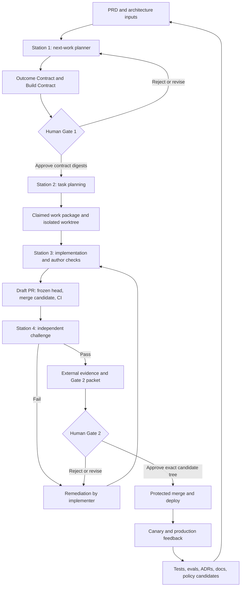

# Reusable AI-Native Software Factory

Status: MVP control plane implemented, GitHub attestation automation pending

Audience: Product owners, technical owners, Codex operators, Claude Code operators, reviewers, and release owners

Current project adapter: `csea/pkms`

Last updated: 2026-07-14

This folder is the reusable software-factory package. It contains factory
policy, schemas, prompts, adapters, validators, evaluations, templates, and
project-specific factory state. The PKMS application remains in `backend/`,
`frontend/`, `product/`, and the existing project task boards. Those are inputs
to the factory, not part of the reusable factory implementation.

Operator manual: [`docs/OPERATOR_MANUAL.md`](docs/OPERATOR_MANUAL.md)

GitHub gate approval: [`docs/GITHUB_GATE_APPROVAL.md`](docs/GITHUB_GATE_APPROVAL.md)

OpenHands integration proposal: [`docs/OPENHANDS_INTEGRATION.md`](docs/OPENHANDS_INTEGRATION.md)

Current runnable entry point:

```bash
python3 software-factory/cli/factoryctl.py doctor
python3 software-factory/cli/factoryctl.py inventory
python3 software-factory/cli/factoryctl.py validate
```

To reuse this factory in another repository, copy or vendor `software-factory/`,
create `software-factory/projects/<project-slug>/project.json`, and supply a
small project adapter for its PRD paths, test commands, CI, deployment, and
agent instruction files. Do not copy PKMS-specific assumptions into the core
schemas, prompts, or runner.

## 1. Executive Decision

Build the software factory as a small, deterministic control plane around Git,
checked-in contracts, isolated worktrees, CI, pull requests, and human approvals.
Codex, Claude Code, gstack, and OMX are execution engines inside that control
plane. They must not be the source of truth for workflow state, approvals, or
verification evidence.

The target operating model is:

1. Humans define product intent, constraints, architecture, risk appetite, and
   acceptable outcomes.
2. Station 1 selects the next eligible outcome and expands it into an Outcome
   Contract and Build Contract.
3. Human Gate 1 approves the exact contract revision, not a conversational
   summary.
4. Station 2 produces a bounded task plan for exactly one work package in the
   MVP.
5. Station 3 implements one claimed work package in an isolated Git worktree.
6. A draft pull request freezes the implementation SHA and starts deterministic
   CI.
7. Station 4 challenges that pull-request SHA from a separate agent session and
   does not repair the implementation itself.
8. The implementer remediates findings and a fresh verification pass challenges
   the new commit.
9. Human Gate 2 reviews the product result, technical evidence, residual risk,
   rollout plan, and rollback plan before merge.
10. CI, deployment checks, canary evidence, incidents, and production feedback
   update tests, evaluations, ADRs, product documents, and only then the durable
   agent instructions.

The factory should start with one work package at a time and two manual gates.
Do not begin with a multi-agent orchestration service or a self-modifying agent
memory system. The first milestone is a complete, auditable path from approved
intent to an independently verified pull request.

## 2. Non-Negotiable Principles

### 2.1 Intent is human-owned

Agents may identify ambiguity, propose options, and recommend a safe default.
They may not invent product intent, silently remove acceptance criteria, or
weaken a constraint to make verification pass.

### 2.2 Advancement is deterministic

Agents may propose that a work package should advance. A schema validator, state
transition rule, CI check, or recorded human gate decides whether it advances.

### 2.3 Verification is independent

The authoring agent cannot approve its own work. Running `/review` or `/qa` in
the same context that wrote the code is useful self-checking, but it is not
independent verification.

At minimum, independent verification requires:

- a fresh agent session;
- a separate role and run identity;
- a clean disposable verifier worktree with tracked-source write denial or a
  post-run cleanliness check;
- an immutable implementation commit SHA;
- the approved contracts as the primary review input;
- an evidence report produced before the verifier sees the implementer's
  persuasive summary; and
- no permission for the verifier to modify the implementation branch before it
  issues its verdict.

### 2.4 Evidence is bound to a commit

"Tests passed" is not sufficient. Evidence must identify the command, exit code,
environment, timestamp, artifact location, and implementation commit. Any code
change after verification invalidates the verification verdict.

### 2.5 Memory is reviewed, not self-written

`AGENTS.md` and `CLAUDE.md` are policy. They are not session scratchpads. Raw
logs, user reports, production incidents, model output, and web content are
untrusted inputs. A learning becomes durable only after it is sanitized,
classified, independently reviewed, and promoted into the right artifact.

Prefer this promotion order:

1. regression test or evaluation;
2. product requirement or acceptance criterion;
3. ADR or architecture documentation;
4. factory policy;
5. agent instruction, only for durable cross-cutting behavior.

### 2.6 Autonomy is risk-bounded

Minimal human intervention does not mean unrestricted agent permissions. It
means routine reversible work advances automatically within an approved
contract while high-risk transitions remain explicit.

## 3. Current Repository Assessment

The repository contains a strong starting point, but it is not ready for
unattended implementation.

| Factory input or control | Current repository artifact | Readiness | Important gap |
| --- | --- | --- | --- |
| Main product intent | `product/01-csea-pkms-prd.md` | Strong | No stable front matter, revision approval, or normalized feature ID |
| Product and technical sequencing | `product/02-csea-pkms-implementation-roadmap.md` | Useful | It also acts as an informal progress ledger and can drift from code |
| Feature implementation specifications | `product/03-projects-system-of-record-implementation.md`, `product/04-work-packages-workflow-implementation.md` | Useful prototypes | Some sections are stale relative to Django apps, Strawberry GraphQL, and `uv` |
| PRD inventory | `product/PRD-inventory.md` | Not ready | It still contains a template `PRD-001`, while active tasks use `PKMS-001` |
| Open decisions | `product/open-questions.md` | Not ready | It still contains a template even though unresolved decisions exist elsewhere |
| User journeys | `product/user-journeys.md` | Partial | Mostly template journeys, so end-to-end outcome evidence is weak |
| Task lifecycle | `tasks/backlog.md` through `tasks/done.md` | Useful prototype | Manual cut-and-paste state, no claim lease, no stable package path, no verifier identity |
| Shared agent rules | `agent.md`, `AGENTS.md`, `CLAUDE.md` | Partial | Rules are split and can drift; Codex and Claude do not receive symmetric scoped instructions |
| Technical architecture | `backend/ARCHITECTURE.md` | Partial | Materially stale in places; no current cross-stack technical architecture |
| ADRs | Mentioned by `agent.md` | Missing | No reusable factory ADR store or PKMS factory-adapter ADR store exists |
| Runtime plans | `.omx/plans/` | Local-only | `.omx/` is excluded locally and is not shared factory memory |
| Backend CI | `.github/workflows/production-be.yml` | Good base, currently red | No Ruff, mypy, migration drift, schema drift, or coverage policy; workflow expects a locally present but untracked `backend/.python-version` |
| Frontend CI | `.github/workflows/production-fe.yml` | Good base, currently red | Registration-copy tests are stale; no lint, codegen drift, Playwright, accessibility, or performance gate |
| Independent review | gstack and OMX review skills are installed | Capability exists | Current documented sequence allows one session to plan, implement, review, QA, and ship |
| Production feedback | Backend health endpoint and deployment workflows | Weak | No repo-visible canary record, observability policy, incident loop, or rollback evidence |

Before autonomous implementation, Phase 0 must normalize the product inventory,
open questions, task status, architecture sources, and known test baseline. A
planner cannot safely choose the next item while the sources of truth disagree.

## 4. Target Architecture

Use four trust layers.

| Trust layer | Responsibility | Authoritative artifacts |
| --- | --- | --- |
| Product authority | Intent, users, outcomes, constraints, risk appetite, product approval | PRDs, user journeys, open questions, Outcome Contract, Gate 1 |
| Factory control plane | Schemas, state, claims, transition rules, hashes, policies, evidence indexes | `software-factory/`, project adapter, control refs, gate decisions |
| Agent execution plane | Planning, decomposition, coding, self-checking, adversarial verification, remediation | Codex, Claude Code, gstack, OMX, local test tools |
| Delivery authority | Objective checks, merge authorization, deployment, canary, rollback | GitHub CI, protected branches, pull requests, environments, production evidence |



## 5. Source-of-Truth Hierarchy

Agents need separate precedence models for intent, observed evidence, and
execution authority. Combining them causes category errors.

### 5.1 Desired-behavior precedence

1. Authenticated human gate decisions bound to artifact hashes.
2. Approved feature PRDs and the main product PRD.
3. Approved Outcome and Build Contracts for the active work package.
4. Accepted ADRs for technical and architectural decisions.
5. Implementation roadmap and generated task indexes.

### 5.2 Observed-state evidence

Use current code, database migrations, generated GraphQL schema, automated
tests, CI, deployed artifact digests, monitoring, and production evidence to
describe what actually exists. Evidence can reveal that desired behavior is not
implemented; it does not silently redefine desired behavior.

### 5.3 Execution authority

System/developer policy, runtime safety controls, root and scoped `AGENTS.md` or
`CLAUDE.md`, and factory security policy remain binding to the agent that loads
them. `agent.md` may be the shared engineering-rule source, but the tool-facing
instruction files remain authoritative adapters in their respective runtimes.

Rules:

- A lower desired-behavior source may reveal drift but may not silently override
  a higher one.
- If approved intent conflicts with code, Station 1 flags the conflict and asks
  whether to change the product or repair the implementation.
- If code and tests disagree, Station 4 treats the approved contract as the
  oracle and records both as evidence.
- Runtime state is resumable convenience, not durable project truth.
- Product facts must not live only in `AGENTS.md`, `CLAUDE.md`, or a chat.

## 6. Recommended Repository Layout

Add the following structure incrementally. Everything in the first block is
factory-owned and reusable. The second block is the thin PKMS adapter.

```text
.
|-- AGENTS.md
|-- CLAUDE.md
|-- agent.md
|-- software-factory/
|   |-- README.md
|   |-- policy.json
|   |-- docs/
|   |   |-- OPERATOR_MANUAL.md
|   |   `-- OPENHANDS_INTEGRATION.md
|   |-- schemas/
|   |   |-- feature-manifest.schema.json
|   |   |-- outcome-contract.schema.json
|   |   |-- build-contract.schema.json
|   |   |-- state.schema.json
|   |   |-- ledger-event.schema.json
|   |   |-- evidence-manifest.schema.json
|   |   |-- verification-report.schema.json
|   |   |-- gate-decision.schema.json
|   |   `-- project-adapter.schema.json
|   |-- prompts/
|   |   |-- next-work-planner.md
|   |   |-- task-planner.md
|   |   |-- implementer.md
|   |   |-- verifier.md
|   |   `-- learning-reviewer.md
|   |-- adapters/
|   |   |-- codex.sh
|   |   `-- claude.sh
|   |-- cli/
|   |   |-- factoryctl.py
|   |   `-- tests/
|   |-- templates/
|   |   |-- github-workflows/
|   |   |-- adr/
|   |   `-- project-config/
|   |-- baselines/
|   |-- evals/
|   |   |-- planner-cases/
|   |   `-- verifier-cases/
|   |-- adr/
|   |-- learnings/
|   |-- incidents/
|   `-- projects/
|       `-- pkms/
|           |-- project.json
|           |-- architecture/
|           |-- adr/
|           |-- work-packages/
|           `-- control/
|-- product/
|   |-- PRD-inventory.md
|   |-- open-questions.md
|   `-- prds/
|       `-- PKMS-001-project-records/
|           |-- prd.md
|           |-- outcome-contract.json
|           |-- outcome-contract.md
|           |-- build-contract.json
|           |-- build-contract.md
|           `-- decisions.md
`-- tasks/
    |-- backlog.md
    |-- in-progress.md
    |-- in-review.md
    |-- qa.md
    |-- done.md
    `-- ... existing project task boards ...
```

The project adapter under `software-factory/projects/pkms/` is the only
PKMS-specific factory content. Runtime control artifacts are kept on the
protected control ref described in Section 6.3 and are never committed onto the
implementation pull request.

### 6.1 Why work-package paths must stay stable

Do not move a feature directory from `tasks/backlog/` to
`tasks/in-progress/` to `tasks/done/`. That makes links unstable, complicates
resumption, and causes avoidable merge conflicts between agents.

Instead:

- store the canonical factory package once under
  `software-factory/projects/<project>/work-packages/<PRD>/<WP>/`;
- store its current lifecycle in control-channel `state.json`;
- append every transition to control-channel `ledger.jsonl`; and
- generate the existing `tasks/backlog.md`, `tasks/in-progress.md`,
  `tasks/in-review.md`, `tasks/qa.md`, and `tasks/done.md` as human-readable
  indexes.

The project task boards remain human-facing views. The reusable factory owns the
stable package path and lifecycle state, while the project adapter maps those
packages to the repository's existing `tasks/*.md` conventions.

Render board views from the control channel into CI artifacts or update them
through a dedicated synchronization PR. Never append live state/evidence commits
to an implementation PR after its subject SHA is frozen.

### 6.2 Why JSON for the control plane

Use Markdown for human reasoning and JSON for state, policy, gates, and evidence.
The MVP can validate JSON with Python's standard library and small explicit
checks, avoiding a new runtime dependency. JSON Schema can be added or validated
with a pinned tool in CI later.

Do not parse arbitrary Markdown prose to decide whether a gate passed.

### 6.3 Separate code and attestation channels

Do not let a pull request commit attest to its own SHA. If `state.json`, a
verification report, or a Gate 2 receipt is committed to the implementation branch,
that commit changes the PR head and immediately makes the prior attestation
stale.

Use two channels:

| Channel | Contents | Authority |
| --- | --- | --- |
| Product/code lineage | Approved canonical contract JSON and generated Markdown on `main`; implementation code on the work-package PR | Normal Git history and implementation PR |
| Control/attestation lineage | Task plan, state, append-only ledger, claims, evidence manifest, verifier reports, CI/check receipts, and gate receipts | Separate protected `factory-control/<WP>` ref or external attestation store |

For the MVP, use a dedicated `factory-control/<WP>` branch and sibling worktree
that is never merged into the implementation PR. Mirror decisive events into
GitHub Check Runs, Actions artifacts, and authenticated PR reviews. A later
service can replace the control branch without changing the artifact contracts.

Logical control-channel layout:

```text
factory-control/<WP> branch
`-- work-packages/<PRD>/<WP>/
    |-- plan.md
    |-- state.json
    |-- ledger.jsonl
    |-- gates/
    |   |-- gate-1-receipt.json
    |   `-- gate-2-receipt.json
    |-- evidence/
    |   |-- manifest.json
    |   `-- README.md
    |-- reviews/
    |   `-- verification-report.json
    `-- remediation/
```

All control artifacts name a `subject_sha`, contract digests, and artifact
hashes. Changing the control branch does not change `subject_sha`. The
implementation PR check compares its current head to the attested `subject_sha`
and fails closed on a mismatch.

Protect the control channel from the implementation and verification identities.
Only the factory recorder identity may append validated events and receipts.
If the current GitHub plan cannot enforce branch protection, keep the recorder
credential out of agent environments and run recorder operations through a
human-controlled boundary.

## 7. Identifier Model

Use stable identifiers everywhere.

| Artifact | Format | Example |
| --- | --- | --- |
| Product PRD | `PKMS-NNN` | `PKMS-001` |
| Acceptance criterion | `AC-NNN` within a PRD revision | `AC-014` |
| Open question | `Q-NNN` | `Q-007` |
| ADR | `ADR-NNNN` | `ADR-0003` |
| Work package | `WP-<PRD>-NNN` | `WP-PKMS-001-007` |
| Remediation cycle | `REM-NNN` | `REM-002` |
| Verification run | `VER-<timestamp>-<short-id>` | `VER-20260714-a91f` |
| Gate decision | `G1-...` or `G2-...` | `G2-WP-PKMS-001-007-02` |
| Ledger event | UUID or sortable unique ID | `evt_...` |

Phase 0 must resolve the current `PRD-001` versus `PKMS-001` drift. The main
PRD should receive one stable ID, and all tasks, PRD inventory rows, contracts,
ADRs, and evidence should use it.

## 8. Work-Package State Machine

```text
candidate
  -> shaping
  -> awaiting_gate_1
  -> approved
  -> planning
  -> ready
  -> claimed
  -> implementing
  -> self_checked
  -> draft_pr_open
  -> ci_pending
  -> verifying
  -> verified
  -> awaiting_gate_2
  -> approved_to_merge
  -> merged
  -> deployed
  -> observing
  -> closed

verifying
  -> remediation
  -> self_checked
  -> draft_pr_open
  -> ci_pending
  -> verifying

awaiting_gate_1
  -> shaping | rejected | deferred | superseded

awaiting_gate_2
  -> remediation | shaping | rejected
```

Exceptional states:

```text
rejected
deferred
cancelled
blocked
verification_failed
rolled_back
superseded
closed_non_runtime
incident_closed
```

### 8.1 Transition guards

| Transition | Required guard |
| --- | --- |
| `shaping -> awaiting_gate_1` | Contracts validate, no blocking ambiguity remains, references resolve, risk is classified |
| `awaiting_gate_1 -> approved` | Human approval is bound to the exact Outcome and Build Contract digests |
| `awaiting_gate_1 -> shaping` | Human requests contract modification or a smaller split |
| `awaiting_gate_1 -> rejected/deferred/superseded` | Authenticated human decision records the terminal or paused disposition |
| `approved -> planning` | Approved contract digest still matches current files |
| `planning -> ready` | Plan is complete, dependencies are ready, work package fits size policy, required tests are named |
| `ready -> claimed` | Atomic claim succeeds, lease is active, branch and worktree are isolated, base SHA is recorded |
| `claimed -> implementing` | Claim owner, lease, branch, worktree, and base SHA still match |
| `implementing -> self_checked` | Author checks pass and implementation is committed |
| `self_checked -> draft_pr_open` | Draft PR exists, its head equals the implementation SHA, and required CI has started |
| `draft_pr_open -> ci_pending` | CI/check suite is recorded for the exact PR head and tested merge candidate |
| `ci_pending -> verifying` | Required deterministic CI passes for the subject and merge-candidate tree; evidence is available on the control channel |
| `verifying -> verified` | Independent report passes every blocking acceptance criterion |
| `verifying -> remediation` | Findings are recorded without weakening the approved contract |
| `verifying -> verification_failed` | Verification cannot satisfy a blocking criterion within policy; report and exhausted remediation evidence are recorded |
| `verifying -> blocked` | Required environment, authority, dependency, or evidence is unavailable; no approval is inferred |
| `remediation -> self_checked` | Fixes are committed; author checks and evidence generation must run again before PR/CI/verification |
| `verified -> awaiting_gate_2` | Draft PR, CI, review report, residual risks, rollout, and rollback are available |
| `awaiting_gate_2 -> approved_to_merge` | Policy-selected authenticated approvers bind approval to unchanged contract, PR head, merge-candidate SHA/tree, evidence, review, rollout, and rollback digests |
| `awaiting_gate_2 -> remediation` | Product or technical review requests implementation changes without changing intent |
| `awaiting_gate_2 -> shaping/rejected` | Requested change affects intent/contract, or human rejects the outcome |
| `approved_to_merge -> merged` | Required checks pass; authenticated approvals remain valid; PR head, merge candidate, candidate tree, and evidence digests are unchanged |
| `merged -> deployed` | Deployment workflow reports the deployed SHA and environment |
| `merged -> closed_non_runtime` | Package has no runtime artifact and closure evidence is complete |
| `deployed -> observing` | Canary and production checks are active |
| `observing -> closed` | Observation policy passes |
| `rolled_back -> remediation/incident_closed` | Incident authority chooses a corrected package or closes the incident with evidence |
| `blocked -> prior safe state` | Blocker resolution is recorded and every normal guard from the resumed checkpoint is re-evaluated; blocked work may not skip a gate or check |

### 8.2 Invalidation rules

- Changing the problem, desired outcome, non-goals, critical acceptance
  criteria, risk class, security constraint, or architecture boundary invalidates
  Gate 1.
- Changing code, dependencies, migrations, generated schema, or build output
  after verification changes the PR head and invalidates the verification report
  and Gate 2. Updating the separate control channel does not change the subject
  SHA.
- Rebasing onto a new base commit requires the policy-selected verification set
  to run again.
- A human may reject or supersede work at either gate. The ledger remains
  append-only.

## 9. Risk and Independence Policy

### 9.1 Risk levels

| Level | Examples | Minimum policy |
| --- | --- | --- |
| `R0` | Documentation, comments, test-only changes | Manual Gate 1 and Gate 2 during MVP; deterministic CI; later eligible for auto-approval |
| `R1` | Reversible application behavior without auth, tenancy, data-model, or deployment changes | Two gates, independent fresh-session review, targeted and regression tests |
| `R2` | Schema migrations, GraphQL contracts, ABAC, tenant scoping, sensitive data, audit, external integrations | Named product and technical approval, cross-provider verification where practical, staging evidence |
| `R3` | Destructive migrations, secrets, production data access, retention/legal policy, infrastructure deletion | No autonomous merge or deploy; named security/operations approval, rollback rehearsal, backup/restore evidence |

Risk is derived from changed surfaces and contract content. An agent may raise
risk but may never lower it. `factoryctl` should calculate a minimum risk class
from path and semantic rules, then compare it with the declared class.

Examples for this repository:

- Changes under `backend/api/apps/abac/`, tenant resolution, permissions,
  authentication, migrations, or production workflows are at least `R2`.
- A destructive migration or operation against production data is `R3`.
- A new isolated component with no persistence or permission change may be `R1`.

### 9.2 Independence levels

| Level | Requirement |
| --- | --- |
| `I0` | Deterministic CI only |
| `I1` | Fresh verifier session, separate worktree, immutable SHA, report-only review |
| `I2` | `I1` plus a different provider or model family where practical and specialist review for the risk surface |
| `I3` | `I2` plus staging, security/operations review, canary, and rollback evidence |

MVP minimum is `I0 + I1`. Use `I2` for ABAC, tenant isolation, migrations,
authentication, sensitive records, external integrations, and deployment logic.
Use `I3` for destructive or production-data operations.

Different subagents inside one parent context improve coverage but are weaker
than separate principals. They can share blind spots, prompts, and author bias.
For high-risk work, prefer Codex implementation with Claude verification or
Claude implementation with Codex verification, plus deterministic CI.

## 10. Artifact Contracts

For the MVP, one Gate 1 contract pair maps to exactly one work package. Station
2 decomposes that package into steps, not additional packages. This keeps risk,
scope, evidence, and approval unambiguous. Later, a feature-level contract may
authorize several package contracts, but every package must then receive its own
validated scope, risk classification, acceptance mapping, and Gate 1 decision.

### 10.1 Feature manifest

`software-factory/projects/<project>/work-packages/<PRD>/<WP>/manifest.json` is
the machine-readable factory inventory record. The product PRD remains in the
project's own `product/` folder.

```json
{
  "schema_version": 1,
  "prd_id": "PKMS-001",
  "title": "Project membership",
  "status": "approved",
  "owners": {
    "product": "human:product-owner",
    "technical": "human:technical-owner"
  },
  "documents": {
    "prd": "product/01-csea-pkms-prd.md",
    "outcome_contract": "software-factory/projects/pkms/work-packages/PKMS-001/WP-PKMS-001-007/outcome-contract.json",
    "build_contract": "software-factory/projects/pkms/work-packages/PKMS-001/WP-PKMS-001-007/build-contract.json"
  },
  "requirements": ["FR-003", "FR-013"],
  "blocking_questions": [],
  "supersedes": null
}
```

### 10.2 Outcome Contract

The Outcome Contract explains what must become true without prescribing the
implementation. The canonical artifact is JSON. Generate `outcome-contract.md`
from it for human review; do not maintain a second hand-edited source.

Minimum canonical shape:

```json
{
  "schema_version": 1,
  "work_package_id": "WP-PKMS-001-007",
  "prd": {
    "id": "PKMS-001",
    "path": "product/01-csea-pkms-prd.md",
    "revision_sha": "..."
  },
  "problem": "Who experiences what problem, with current evidence.",
  "desired_outcome": "The observable change for the user or operator.",
  "target_users": ["project administrator"],
  "journey_refs": ["J-101"],
  "requirement_refs": ["FR-003", "FR-013"],
  "acceptance_criteria": [
    {
      "id": "AC-001",
      "statement": "Observable and falsifiable result.",
      "oracle": "automated-test",
      "evidence_required": ["pytest-result"],
      "criticality": "blocking"
    }
  ],
  "invariants": ["Tenant context admitted by the guard is used by the service."],
  "non_goals": ["No unrelated authorization redesign."],
  "success_metrics": [
    {
      "metric": "cross_tenant_resolution_mismatch_count",
      "target": 0,
      "window": "30d"
    }
  ],
  "ambiguities": [],
  "failure_and_rollback_outcome": "Requests fail closed without cross-tenant access."
}
```

Station 1 may not submit Gate 1 with a blocking ambiguity. If the PRD does not
define the acceptable outcome, the correct output is a flagged question with a
recommendation, not invented intent.

### 10.3 Build Contract

The Build Contract constrains how the outcome may be achieved. The canonical
artifact is JSON, with generated Markdown for review.

Minimum canonical shape:

```json
{
  "schema_version": 1,
  "work_package_id": "WP-PKMS-001-007",
  "architecture_refs": [
    "docs/architecture/technical-architecture.md",
    "software-factory/projects/pkms/adr/ADR-0003-tenant-resolution.md"
  ],
  "allowed_paths": ["backend/api/apps/messaging/", "backend/api/apps/notifications/"],
  "forbidden_paths": [".github/workflows/production-be.yml"],
  "interfaces_changed": [],
  "security_privacy_constraints": [
    "Fail closed when tenant context is absent.",
    "Do not log secrets or personal data."
  ],
  "migration": {
    "required": false,
    "strategy": "none",
    "rollback": "revert the implementation commit"
  },
  "observability": ["cross_tenant_resolution_mismatch_count"],
  "required_checks": [
    "backend-django-check",
    "backend-migration-drift",
    "backend-ruff",
    "backend-pytest"
  ],
  "adversarial_scenarios": [
    "header-derived tenant differs from the user's default tenant",
    "tenant context is absent"
  ],
  "rollout": "normal protected merge and backend deployment",
  "rollback": "revert and redeploy the prior artifact",
  "risk": {
    "level": "R2",
    "reasons": ["tenant isolation"],
    "required_independence": "I2",
    "required_approver_roles": ["product-owner", "technical-owner"]
  },
  "budgets": {
    "max_remediation_cycles": 3,
    "max_scope_expansion": "none"
  }
}
```

The Build Contract should reference existing repository rules rather than copy
them. For example, GraphQL permission enforcement, UUID boundary rules, email
branding, and frontend feedback behavior already exist in repo instructions.

### 10.4 Work-package manifest

`software-factory/projects/<project>/work-packages/<PRD>/<WP>/manifest.json`
connects all factory artifacts.

```json
{
  "schema_version": 1,
  "work_package_id": "WP-PKMS-001-007",
  "prd_id": "PKMS-001",
  "title": "Replace JSON assignments with project membership",
  "contract_revision": 1,
  "outcome_contract": "software-factory/projects/pkms/work-packages/PKMS-001/WP-PKMS-001-007/outcome-contract.json",
  "build_contract": "software-factory/projects/pkms/work-packages/PKMS-001/WP-PKMS-001-007/build-contract.json",
  "risk": "R2",
  "independence": "I2",
  "dependencies": [],
  "acceptance_criteria": ["AC-001", "AC-002", "AC-003"],
  "allowed_paths": [
    "backend/api/apps/accounts/",
    "backend/api/apps/projects/",
    "backend/config/schema.py",
    "backend/schema.graphql"
  ],
  "forbidden_paths": [".github/workflows/production-be.yml"],
  "max_remediation_cycles": 3
}
```

### 10.5 State

`state.json` is the current snapshot, not the history. It lives on the control
channel, never on the implementation PR.

```json
{
  "schema_version": 1,
  "work_package_id": "WP-PKMS-001-007",
  "state": "verifying",
  "previous_state": "ci_pending",
  "updated_at": "2026-07-14T12:00:00Z",
  "contract_digests": {
    "outcome": "sha256:...",
    "build": "sha256:..."
  },
  "git": {
    "base_sha": "...",
    "implementation_sha": "...",
    "merge_candidate_sha": "...",
    "merge_candidate_tree": "...",
    "branch": "factory/WP-PKMS-001-007",
    "worktree": "../pkms-WP-PKMS-001-007",
    "pr": 123
  },
  "claim": {
    "owner": "codex:run-id",
    "claimed_at": "2026-07-14T10:00:00Z",
    "lease_expires_at": "2026-07-14T14:00:00Z"
  },
  "attempt": 1,
  "next_action": "Run independent verification",
  "blockers": []
}
```

### 10.6 Append-only ledger

`ledger.jsonl` records one JSON object per event.

Required fields:

- schema version;
- event ID and UTC timestamp;
- work-package ID;
- actor identity, role, provider, and run/session ID;
- previous and next state;
- command or decision type;
- reason;
- base, implementation, and PR SHAs when relevant;
- contract and evidence hashes;
- `previous_event_hash` and calculated `event_hash`;
- links to generated artifacts; and
- result or failure code.

Never rewrite or delete prior events. Corrections are new events that reference
the event being corrected. Each event hashes the canonical prior event and its
own canonical content. Gate receipts bind the current ledger-tail hash. CI
compares the proposed ledger with the protected control ref and accepts only a
correctly chained append, making deletion, rewriting, or reordering detectable.

### 10.7 Evidence manifest

The evidence manifest maps every acceptance criterion to proof.

```json
{
  "schema_version": 1,
  "work_package_id": "WP-PKMS-001-007",
  "implementation_sha": "...",
  "pr_head_sha": "...",
  "merge_candidate_sha": "...",
  "merge_candidate_tree": "...",
  "environment": "local-isolated-worktree",
  "generated_at": "2026-07-14T12:30:00Z",
  "claims": [
    {
      "acceptance_id": "AC-001",
      "oracle": "automated-test",
      "command": "cd backend && uv run pytest api/apps/projects/tests/test_project_membership_service.py",
      "exit_code": 0,
      "artifact": "evidence/AC-001-pytest.txt",
      "artifact_sha256": "...",
      "producer": "codex:run-id"
    }
  ],
  "known_gaps": []
}
```

Store small summaries on the control branch or in a post-merge documentation PR,
not on the implementation PR they attest. Store large logs, screenshots, videos,
coverage HTML, and traces in CI artifacts or object storage, then record stable
URLs and hashes. Never commit secrets, tokens, production data, or private user
content.

### 10.8 Independent verification report

The report must include:

- verifier identity, provider, model/runtime, run ID, and independence level;
- exact implementation SHA, PR head SHA, merge-candidate SHA, and tested tree
  digest as applicable;
- exact contract digests;
- acceptance criteria evaluated;
- commands and artifacts examined;
- adversarial scenarios attempted;
- findings ordered by severity with file and line evidence;
- untested areas and evidence gaps;
- architectural status: `CLEAR`, `WATCH`, or `BLOCK`;
- recommendation: `APPROVE`, `COMMENT`, or `REQUEST_CHANGES`; and
- a declaration that the verifier did not modify the implementation branch
  before issuing the report.

Approval requires all blocking acceptance criteria to pass, no unresolved
critical or high finding, architectural status `CLEAR`, and complete evidence.
Missing independent evidence is a failure, not an implicit approval.

### 10.9 Human gate decisions

Gate receipt files record human authority bound to exact artifact versions. They
are not the source of that authority. An agent-written string such as
`"approver": "human:product-owner"` proves nothing.

An approval must originate from one of:

- an authenticated GitHub pull-request review from an authorized actor/team;
- an authenticated protected-environment approval;
- a verified cryptographic signature from an authorized approver; or
- a human-controlled recording service that signs the receipt.

`factoryctl` ingests and verifies the source event, then writes a receipt on the
separate control channel. It never creates an approval.

Gate 1 must record:

- one or more approvals with immutable actor ID, authenticated role/team,
  source event ID/URL, timestamp, and signature or platform verification;
- decision: approve, modify, reject, or defer;
- Outcome and Build Contract digests;
- risk and independence level;
- conditions or expiry;
- timestamp and decision rationale.

Gate 2 must record:

- one or more authenticated approvals; `R2` and `R3` require distinct product
  and technical/security roles according to policy;
- pull request, exact head SHA, tested merge-candidate SHA, and merge-candidate
  tree digest;
- evidence manifest and verification report digests;
- product review result;
- technical review result;
- known residual risks;
- rollout and rollback approval;
- decision and timestamp.

Changing an approved digest, PR head, or merge-candidate tree requires a new
decision. A comment such as "LGTM" without the bound commit, verified actor, and
evidence is not a factory gate.

## 11. Station 1: Next-Work Planner

### 11.1 Objective

Select the highest-value eligible outcome, then produce a complete Outcome
Contract and Build Contract for human review.

### 11.2 Inputs

- main PRD and approved feature PRDs;
- product and technical architecture;
- accepted ADRs;
- current codebase and current branch state;
- task and milestone progress;
- current CI and known-failure baseline;
- test and evaluation history;
- open questions and dependencies;
- incidents, support issues, security findings, and production feedback; and
- active work-package claims.

### 11.3 Deterministic eligibility before LLM ranking

Before asking an agent to rank work, `factoryctl` should exclude items that:

- have unresolved blocking product questions;
- reference missing or contradictory PRDs;
- depend on incomplete work;
- overlap an active worktree claim;
- require an unapproved architecture decision;
- cannot fit the configured work-package size;
- lack a testable outcome; or
- exceed available authority, environment, or credentials.

### 11.4 Ranking policy

Rank eligible candidates in this order:

1. active incident, security, tenant-isolation, or data-integrity repair;
2. broken required checks or release blockers;
3. dependency unblockers for the approved roadmap;
4. product value and journey criticality;
5. risk reduction and learning value;
6. smallest independently deliverable slice;
7. cost and implementation effort.

The planner returns one recommendation and up to two alternatives with explicit
tradeoffs. It does not start implementation.

For the current backlog, the silent-data-loss concern in `T-010` and the
cross-tenant correctness concern in `T-011` should normally rank above net-new
feature `T-008`, subject to human confirmation of risk and current branch work.

### 11.5 Planner output

- selected candidate and ranking rationale;
- rejected or deferred candidates with reason codes;
- Outcome Contract;
- Build Contract;
- ambiguity report;
- risk and independence classification;
- proposed acceptance-to-evidence map; and
- Gate 1 request.

### 11.6 Stop condition

Station 1 stops in `awaiting_gate_1` when both contracts validate and no blocking
ambiguity remains. It stops in `blocked` when human intent or authority is
missing. It must never proceed directly to code.

## 12. Human Gate 1

Human Gate 1 answers five questions:

1. Is this the right next outcome?
2. Does the contract express the intended product behavior?
3. Are non-goals and architecture boundaries correct?
4. Is the risk class high enough and is the verification independence adequate?
5. Is the evidence plan capable of proving success?

Allowed decisions:

- `approve`: bind approval to the current contract digests;
- `modify`: return named changes to Station 1 and require new digests;
- `reject`: close the candidate with a reason;
- `defer`: retain it without making it eligible; or
- `split`: require smaller contracts.

Gate 1 is not approval of an implementation plan or code. It is approval of the
outcome and build boundaries.

Record Gate 1 through a planning-only pull request that contains the normalized
PRD references, canonical contract JSON, generated Markdown, and risk
classification. Authorized humans submit authenticated GitHub reviews or signed
approvals; `factoryctl` ingests them and records receipts on the control channel.
The human or delivery identity then merges that artifact PR, and the
implementation branch starts from the Gate 1 merge commit. This prevents an
implementation agent from silently rewriting the approved contract on its own
branch. If the repository cannot enforce approvals, only the human-held
credential may merge the planning PR.

## 13. Station 2: Task Planning

### 13.1 Objective

Turn an approved contract into a dependency-ordered, testable plan. The plan
must be detailed enough that Codex or Claude Code can resume it from disk without
access to the original conversation.

### 13.2 Required plan content

- base commit and affected packages;
- current implementation patterns to reuse;
- dependency graph;
- interfaces and data flows;
- migration sequence and rollback sequence;
- one work package at a time;
- file ownership and allowed paths;
- test-first or behavior-lock steps where appropriate;
- required generated artifacts;
- author self-checks;
- independent challenge scenarios;
- documentation and ADR updates;
- risks, unknowns, and explicit stop conditions.

### 13.3 Work-package sizing

The current `tasks/backlog.md` targets 30 to 60 minutes. Keep that as a heuristic,
not a correctness rule. A work package is correctly sized when it:

- produces one coherent observable change;
- can be verified independently;
- has one primary owner and one isolated worktree;
- does not require an unapproved scope expansion;
- has a safe rollback or can be left unmerged; and
- can reach a committed, reviewable state in one agent execution window.

Split frontend and backend only when each slice remains useful and testable. Do
not split merely to satisfy a time estimate if it creates an unshippable state.

### 13.4 Planner challenge

For significant work, use a writer/reviewer separation:

- one planner writes `plan.md`;
- a separate engineering reviewer challenges architecture, data flow, edge
  cases, permissions, migrations, tests, and rollback;
- the planner resolves findings and records rejected alternatives; and
- `factoryctl validate` confirms the plan still matches the approved contracts.

Suitable installed tools include gstack `/plan-ceo-review` for product challenge
and `/plan-eng-review` for engineering challenge. These improve planning but do
not replace Gate 1.

### 13.5 Stop condition

Station 2 stops at `ready`. It must not claim a worktree until dependencies,
contracts, and the plan validate.

## 14. Claiming, Branches, and Worktrees

Autonomous Codex and Claude sessions must not share one dirty worktree. The
current repository already has substantial uncommitted work, demonstrating why
isolation is required.

### 14.1 Claim protocol

`factoryctl claim <WP>` should atomically:

1. verify the package is `ready` and unclaimed;
2. record the current base SHA;
3. create `factory/<WP>` from the approved base;
4. create a sibling Git worktree for that branch;
5. record actor, provider, run ID, claim time, and lease expiry;
6. verify allowed and forbidden paths;
7. transition `ready -> claimed`; and
8. append the ledger event.

Claims have leases. A crashed agent does not permanently own a package. Lease
recovery must verify that no process is active, preserve any commits, and append
a takeover event. Never silently delete a worktree with uncommitted changes.

### 14.2 Concurrency rules

- One implementation owner per work package.
- One branch and one worktree per work package.
- Two packages with overlapping allowed paths may not implement concurrently
  unless the plan explicitly assigns non-overlapping ownership.
- Verification uses another worktree at the immutable implementation SHA.
- The verifier may create adversarial tests on its own branch, but it may not
  commit repairs to the implementation branch.
- Generated files such as `backend/schema.graphql` and frontend GraphQL types
  need explicit ownership because they are high-conflict shared artifacts.

## 15. Station 3: Implementation

### 15.1 Objective

Implement exactly one approved work package, preserve unrelated work, produce
evidence, and freeze a reviewable commit.

### 15.2 Required execution loop

1. Load the approved contracts, plan, repo instructions, relevant ADRs, and
   current state.
2. Confirm the worktree is isolated and clean at the recorded base SHA.
3. Inspect existing code patterns before editing.
4. Lock existing behavior with regression tests when changing or cleaning up
   behavior without adequate coverage.
5. Implement the smallest coherent change.
6. Run targeted tests after each meaningful change.
7. Run the contract-required validation set.
8. Update generated schema/types and documentation when required.
9. Review the diff for scope escape, secrets, generated debris, and unrelated
   changes.
10. Commit with the repository's Lore Commit Protocol.
11. Record the implementation SHA and author evidence.
12. Transition to `self_checked`.

### 15.3 Scope control

If implementation discovers a needed change outside allowed paths:

- stop that branch of work;
- record the evidence and proposed change;
- classify it as an implementation detail, contract amendment, or separate work
  package;
- amend Gate 1 only when intent, risk, architecture, or critical acceptance
  changes; and
- never hide the expansion in the final summary.

### 15.4 Author self-checks

The author should use the smallest checks that prove the changed behavior, then
the broader checks required by risk and repository policy.

Current useful commands include:

```bash
# Backend
cd backend
PYTHONPATH=. DJANGO_SETTINGS_MODULE=config.settings.test uv run python manage.py check
PYTHONPATH=. DJANGO_SETTINGS_MODULE=config.settings.test uv run python manage.py makemigrations --check --dry-run
uv run ruff check .
PYTHONPATH=. DJANGO_SETTINGS_MODULE=config.settings.test uv run pytest

# Frontend
cd frontend
yarn type-check
yarn lint
yarn test:run
yarn build
yarn test:e2e

# GraphQL changes
cd frontend
NEXT_PUBLIC_GRAPHQL_ENDPOINT=../backend/schema.graphql yarn codegen
```

The Build Contract should select required checks by affected surface. It should
not require every expensive command for a documentation-only change, and it
must not omit migrations, permissions, schema/codegen, or browser checks when
those surfaces change.

### 15.5 Codex adapter

Interactive Codex should follow `AGENTS.md`, scoped `AGENTS.md` files, the work
package contracts, and `plan.md`. Scripted execution can use `codex exec` with a
prompt file and structured output. Do not use sandbox bypass flags outside an
isolated disposable runner.

The adapter should capture:

- Codex CLI version;
- run/session ID;
- prompt and contract digests;
- base and final SHAs;
- sandbox and network policy;
- final structured status; and
- token/cost data when available.

### 15.6 Claude Code adapter

Interactive Claude Code should follow `CLAUDE.md`, scoped Claude rules, the work
package contracts, and `plan.md`. Scripted execution can use `claude -p` with an
explicit tool allowlist and structured output. For CI, prefer isolated
configuration over inheriting untracked user settings.

Project hooks may enforce deterministic behavior such as:

- blocking destructive shell commands;
- validating allowed paths before writes;
- running formatters or targeted checks after edits;
- refusing `TaskCompleted` or `Stop` when required evidence is absent; and
- recording session and subagent lifecycle events.

Hooks are safeguards, not the sole evidence store. The protected control-channel
ledger and CI remain authoritative.

### 15.7 gstack and OMX inside Station 3

Use installed skills as bounded capabilities:

| Need | Suitable surface |
| --- | --- |
| Product challenge | gstack `/plan-ceo-review` |
| Engineering challenge | gstack `/plan-eng-review` |
| Root-cause debugging | gstack `/investigate` |
| Implementation persistence | OMX `$ralph` or `$ultragoal` in a supported runtime |
| Parallel bounded implementation | Codex native subagents or OMX `$team` when coordination value exceeds overhead |
| Author self-review | gstack `/review` or OMX `$code-review` |
| Author QA and repair | gstack `/qa` or OMX `$ultraqa` |
| Mutating PR preparation | gstack `/ship` before the final author freeze, followed by fresh author checks |

These tools do not own factory state. `.omx/` state may help resume a session but
must checkpoint durable results into the control-channel work-package artifacts.

Do not invoke OMX `$ralph` as an unqualified shortcut. Its implementation lane
requires approved PRD and test-spec planning artifacts. The adapter must generate
or verify `.omx/plans/prd-*.md` and `.omx/plans/test-spec-*.md` from the approved
factory contracts before Ralph begins, or use direct Codex/Claude execution.

gstack `/ship` can merge the base, modify version/changelog files, generate or
fix tests, commit, push, and open a PR. If used, run it before the package enters
`self_checked`; then rerun author validation and freeze the resulting SHA. Never
run it after independent verification without invalidating and repeating the
full CI, verification, and Gate 2 sequence.

OMX team, HUD, and question surfaces require an attached tmux OMX runtime. Codex
App sessions should use native subagents or direct execution unless an OMX CLI
session is explicitly launched.

Run `omx doctor` before relying on local OMX runtime components. The current
machine audit reports setup warnings, and neither global gstack installation nor
hidden plugin state is a reproducible repository dependency.

### 15.8 Stop condition

Station 3 stops at `self_checked` with a committed implementation SHA, complete
author evidence, and no unrecorded scope drift. It does not declare the package
verified or merge-ready.

## 16. Station 4: Independent Verification

### 16.1 Objective

Try to prove the implementation is wrong, incomplete, unsafe, or inconsistent
with the approved contracts before a human authorizes merge.

### 16.2 Verifier inputs

The verifier receives:

- approved Outcome and Build Contracts;
- risk and independence policy;
- relevant PRD, ADR, architecture, and repo instructions;
- base SHA, immutable PR head SHA, merge-candidate SHA, and candidate tree digest;
- current deterministic CI results for the exact subject and merge candidate;
- versioned known-failure baseline; and
- a disposable verification worktree that permits declared cache/build outputs
  but denies or detects tracked-source edits.

The implementer's summary is secondary input. Give it to the verifier after the
verifier forms an initial view, or label every claim as untrusted until proven.

### 16.3 Required verification lanes

1. **Contract compliance:** Map every acceptance criterion to evidence.
2. **Regression:** Challenge nearby behavior and invariants.
3. **Architecture:** Examine boundaries, coupling, data flow, migrations, and
   long-term tradeoffs.
4. **Security and privacy:** Challenge auth, ABAC, tenant isolation, inputs,
   outputs, logs, secrets, and sensitive data as applicable.
5. **Operational:** Challenge deployability, observability, failure handling,
   rollback, concurrency, performance, and data recovery.
6. **Product and UX:** Exercise the named user journey, action feedback,
   accessibility, and error recovery when applicable.

### 16.4 Installed verifier surfaces

Run these in a separate session from the implementer:

| Verification need | Suitable independent surface |
| --- | --- |
| Report-only diff review | OMX `$code-review` with required independent lanes, Codex GitHub review, or a dedicated read-only Claude/Codex reviewer |
| Report-only browser QA | gstack `/qa-only` |
| Security-sensitive change | gstack `/cso` or a dedicated security reviewer |
| Performance-sensitive change | gstack `/benchmark` |
| Post-deploy health | gstack `/canary` |

Using the same tool name does not create independence. The verifier principal,
context, workspace, input SHA, and authority must be separate.

gstack `/review` and `/qa`, and OMX `$ultraqa`, are fix-capable workflows. Keep
them in author self-check or remediation lanes. A fresh report-only verifier must
still challenge the resulting SHA. Never call a fix-capable pass the final
independent gate merely because it ran in another session.

### 16.5 Known failures

Do not accept prose such as "this failure is pre-existing" without a checked-in
baseline entry that includes:

- stable failure ID;
- exact test or check;
- first known commit;
- owner;
- linked backlog item;
- impact and risk;
- expiry or review date; and
- evidence that the active change did not worsen it.

An expired baseline blocks approval.

### 16.6 Verdict

The verifier writes `reviews/verification-report.json` and a human-readable
Markdown summary to the control channel or CI artifact store, never onto the
implementation PR. It then proposes one transition:

- `verifying -> verified`;
- `verifying -> remediation`;
- `verifying -> verification_failed`; or
- `verifying -> blocked` when the environment cannot prove a required claim.

The verifier never marks `approved_to_merge`.

## 17. Remediation Loop

The remediation loop must preserve independence and prevent endless agent work.

1. Verifier records findings against the frozen SHA.
2. Implementer owns remediation on the implementation branch.
3. Implementer maps each finding to a code, test, documentation, or contract
   response.
4. Contract weakening is prohibited. A legitimate intent change returns to
   Station 1 and Gate 1.
5. Implementer commits remediation and reruns author checks/evidence generation.
6. The draft PR head changes, which invalidates prior CI, verification, and Gate
   2 receipts.
7. CI tests the new head and merge-candidate tree.
8. A fresh verification run challenges the new SHA.
9. The ledger links each finding, remediation commit, and re-verification result.

Default maximum: three failed remediation cycles. After three cycles, stop and
escalate with:

- repeated failure signature;
- attempted fixes;
- suspected root cause;
- contract or architecture tension;
- evidence artifacts; and
- recommended human decision.

Retry only transient environment failures automatically. A deterministic test
failure is remediation work, not retry noise.

## 18. Pull Request and Human Gate 2

### 18.1 PR contents

Open the draft PR immediately after Station 3 reaches `self_checked`, before
Station 4. The initial PR body contains the contracts, work-package ID, author
summary, and provisional evidence links. This triggers current PR-only CI.

The factory updates the PR body, external check runs, and control-channel
attestations as verification proceeds. Those updates must not create commits on
the implementation branch. The final Gate 2 packet must include:

- Outcome Contract summary;
- Build Contract and ADR links;
- work-package ID;
- exact implementation SHA, PR head, merge-candidate SHA, and tested tree digest;
- changed behavior and non-goals;
- migration and data implications;
- permission, tenant, security, and privacy implications;
- acceptance-criterion evidence table;
- independent verification verdict and findings resolved;
- CI results and known gaps;
- screenshots or journey evidence where relevant;
- rollout, canary, and rollback plan;
- documentation and memory updates; and
- residual risks requiring human judgment.

The summary explains what was done and how it was proven. It must not substitute
for the linked evidence.

### 18.2 Gate 2 review

Human Gate 2 answers:

1. Does the delivered behavior satisfy the approved outcome?
2. Is the technical implementation acceptable at the declared risk?
3. Is verification sufficiently independent and complete?
4. Are migrations, rollout, observability, and rollback acceptable?
5. Are residual risks understood and owned?

Gate 2 occurs before merge. In this repository, backend and frontend workflows
deploy on pushes to `main`, so approving merge may also authorize production.
Branch protection and GitHub production-environment protection must reflect that
fact.

Any commit after Gate 2 invalidates the approval and requires the policy-selected
checks, verification, and gate decision to run again.

### 18.3 Merge-candidate and deployed-artifact binding

The feature-branch head is not necessarily the commit deployed from `main`.
Merge commits, squash merges, rebases, and merge queues can create a different
commit.

Record the selected merge strategy in an ADR. For the MVP:

1. required CI and Station 4 test the exact GitHub merge candidate or merge-group
   ref in addition to the feature head;
2. Gate 2 binds the feature head, merge-candidate SHA, and candidate Git tree
   digest;
3. the delivery identity refuses a merge if the candidate changes;
4. after merge, CI proves the resulting `main` Git tree digest equals the
   approved candidate tree digest;
5. production evidence binds the final `main` SHA and deployed artifact digest;
   and
6. any tree mismatch blocks deployment and requires new verification/approval.

This tree-digest check permits GitHub to create a different merge commit while
proving that the deployed source tree is exactly what Gate 2 approved.

## 19. Learn, Update, and Factory Memory

### 19.1 Learning pipeline

```text
production or verification signal
  -> sanitized evidence
  -> learning candidate
  -> independent review
  -> regression test, eval, ADR, PRD, policy, or rejection
```

Classify every candidate as one of:

- observed fact;
- hypothesis;
- product decision;
- technical decision;
- operational rule;
- model/tool behavior; or
- rejected lesson.

Never promote a hypothesis as a rule.

### 19.2 What updates where

| Learning | Durable destination |
| --- | --- |
| Product behavior was underspecified | PRD, user journey, acceptance criterion, open question |
| Architecture choice or tradeoff | ADR and technical architecture |
| Regression or recurring defect | Automated test or evaluation |
| Verification blind spot | Verifier prompt, evaluation case, or factory policy |
| Operational failure | Incident record, canary, runbook, rollback check |
| Durable cross-repo coding invariant | `agent.md`, then mirrored Codex/Claude adapter rules |
| Tool-specific invocation behavior | Tool adapter or prompt, not product docs |
| One-off session detail | Ledger or run artifact, not agent instructions |

### 19.3 Agent instruction architecture

Use `agent.md` as the canonical shared engineering policy, then make tool-facing
files thin adapters:

- root `AGENTS.md` tells Codex to load the factory guide, active package, and
  scoped Codex rules;
- root `CLAUDE.md` tells Claude Code the same, using Claude-specific hooks and
  skill invocation syntax;
- `backend/AGENTS.md` mirrors the durable backend rules currently only in
  `backend/CLAUDE.md`;
- `frontend/AGENTS.md` mirrors durable frontend rules currently only in
  `frontend/CLAUDE.md`;
- a drift check compares shared rule identifiers across all adapters.

Do not duplicate the entire factory guide into every instruction file. Large
duplicated policies drift and consume agent context.

## 20. Deterministic Control Plane: `factoryctl`

The MVP implements one small Python CLI under
`software-factory/cli/factoryctl.py`. It uses Python's standard library and
does not call an LLM. Agents call it to validate contracts, write gate packets,
record state transitions, and render board views.

Implemented commands:

```text
factoryctl doctor
factoryctl inventory
factoryctl select-next [--shadow]
factoryctl create <PRD> <WP>
factoryctl validate [<WP>]
factoryctl status <WP>
factoryctl submit-gate <WP> --gate 1|2
factoryctl ingest-gate <WP> --gate 1|2 --source-event <path>
factoryctl claim <WP> --actor <id> --lease <duration>
factoryctl release <WP> --actor <id>
factoryctl transition <WP> --to <state> --evidence <path>
factoryctl record-verdict <WP> <report>
factoryctl generate-boards
factoryctl digest <path>
```

`submit-gate` writes both a machine/audit request and a GitHub-ready PR body.
Humans review and approve the PR body; `factoryctl` keeps JSON as the audit
format behind that surface.

Planned commands after the local control plane is hardened:

```text
factoryctl plan <WP>
factoryctl renew <WP> --actor <id>
factoryctl freeze <WP>
factoryctl verify <WP> --verifier <id>
factoryctl remediate <WP> <finding-id>
factoryctl prepare-pr <WP>
factoryctl record-deploy <WP> --environment <name> --sha <sha>
factoryctl learn <WP>
factoryctl resume <WP>
```

### 20.1 MVP responsibilities

The CLI should initially do only deterministic work:

- validate JSON and required Markdown sections;
- resolve file references;
- calculate SHA-256 digests;
- enforce state transitions;
- manage claims and leases;
- verify Git branch, worktree, and commit conditions;
- append ledger events;
- render board indexes;
- check evidence coverage for acceptance criteria;
- ensure verifier and implementer identities differ;
- verify authenticated gate source events and required distinct roles;
- verify event hash chains and ledger-tail receipts;
- verify PR head and merge-candidate tree bindings;
- enforce remediation budgets; and
- emit machine-readable status and human-readable diagnostics.

The CLI should not call an LLM in the first milestone. Agent adapters invoke
Codex or Claude and then submit structured outputs to `factoryctl`.

### 20.2 Idempotency

Every command that changes state needs an idempotency key. Replaying the same
successful operation should return the prior result. Reusing the key with
different inputs should fail.

Use atomic file replacement for `state.json`, file locking for local mutation,
and optimistic checks against the previous state and ledger tail. This is
sufficient only for the single-host, single-package MVP.

Before multi-host parallelism, implement compare-and-swap against the protected
control ref or a dedicated claim service/GitHub App. A normal pull request or
branch alone does not prevent two hosts from claiming the same package before
either writes its claim.

### 20.3 Automation event loop

Add a thin runner around `factoryctl` only after the deterministic commands are
tested. The runner invokes an agent adapter for one station, validates the
result, persists it, and exits. It does not keep a single privileged agent alive
across the whole lifecycle.

Proposed tracked entry points:

```text
software-factory/cli/run-station.py
software-factory/adapters/codex.sh
software-factory/adapters/claude.sh
software-factory/templates/github-workflows/factory-planner.yml
software-factory/templates/github-workflows/factory-execute.yml
software-factory/templates/github-workflows/factory-verify.yml
software-factory/templates/github-workflows/factory-observe.yml
```

GitHub only executes workflow files from `.github/workflows/`. Keep those files
as thin project-owned wrappers that call the reusable templates or workflows in
`software-factory/templates/github-workflows/`; do not put factory logic in the
wrappers.

Event mapping:

| Event | Automated action | Hard stop |
| --- | --- | --- |
| Schedule, package closure, incident intake, or manual dispatch | Run Station 1 in read-only shadow mode and open/update a planning-only PR | Human Gate 1 |
| Gate 1 artifact PR merged | Run Station 2, validate plan, create claim and isolated implementation worktree | Missing dependency, invalid plan, or risk policy |
| Package becomes `claimed` | Dispatch Station 3 to the configured Codex or Claude implementer | Scope escape, authority, environment, or contract drift |
| Package becomes `self_checked` | Open/update the draft PR, freeze its head, and start required CI | Missing PR or mismatched head SHA |
| Draft PR CI passes | Record PR head plus merge-candidate SHA/tree and dispatch Station 4 with a different verifier principal | Missing independence, failed CI, or missing evidence |
| Verifier requests changes | Dispatch a bounded remediation run to the implementer | Contract change or remediation budget exhausted |
| Verifier approves | Update the external PR check/attestation and submit Gate 2 packet without changing the PR | Human Gate 2 |
| Gate 2 approves | Human or separately authorized delivery identity merges the approved merge candidate | Changed head/tree or failed required check |
| Deployment completes | Dispatch observation/canary workflow | Canary failure triggers rollback path |
| Observation passes or rollback completes | Create learning candidate and update package state | Human review before durable policy promotion |

Use a GitHub Actions concurrency group keyed by work-package ID so only one
state-changing run for a package executes at a time. The implementation and
verification workflows must use different service identities, secrets, prompt
files, and permissions. Neither identity receives a token capable of pushing to
`main` or dispatching production. The delivery identity does not implement or
verify code.

Each adapter receives only:

- work-package path;
- station name;
- exact base or implementation SHA;
- explicit prompt file;
- allowed tools and paths;
- sandbox and network policy;
- output schema; and
- run ID and idempotency key.

The adapter writes structured output to a temporary run directory. The runner
validates and promotes only accepted artifacts into the stable package. Failed
or malformed output is retained as diagnostic evidence and cannot advance state.

Start this loop from a human-controlled local runner or a tightly isolated CI
runner. Do not use a developer's untracked global Claude, Codex, gstack, or OMX
configuration as a production factory dependency.

## 21. CI and GitHub Enforcement

### 21.1 Add a factory validation workflow

Create a reusable validator under `software-factory/templates/github-workflows/`
and a thin `.github/workflows/factory-validate.yml` project wrapper that runs on
every pull request and relevant push. It should:

1. validate all feature and work-package manifests;
2. validate allowed state transitions and append-only ledgers;
3. verify PRD, ADR, question, task, and evidence references;
4. ensure every active task has one stable package and one claim;
5. ensure board indexes match generated output;
6. ensure Gate 1 digests match approved contracts;
7. ensure verification and Gate 2 target the PR head SHA;
8. ensure the tested/approved merge-candidate tree matches the current candidate;
9. ensure every blocking acceptance criterion has evidence;
10. ensure verifier identity differs from implementer identity;
11. verify gate source events, approver roles, and control-channel hash chain;
12. reject unowned or expired known-failure baselines; and
13. publish a concise factory status artifact.

### 21.2 Close existing CI gaps

Backend pull requests should add, as applicable:

- `uv run ruff check .`;
- `uv run mypy ...` after narrowing the current permissive configuration;
- `manage.py makemigrations --check --dry-run`;
- generated `backend/schema.graphql` drift detection;
- targeted coverage policy for changed critical modules;
- security/dependency checks; and
- migration tests for `R2` changes.

Frontend pull requests should add, as applicable:

- `yarn lint`;
- generated GraphQL type drift detection;
- Playwright journeys selected from affected routes;
- accessibility checks for changed interactive surfaces;
- bundle/performance budgets for sensitive routes; and
- cross-stack GraphQL contract validation.

Do not enable every strict check in blocking mode on day one. First record the
baseline, create owned cleanup packages, and ratchet checks so new changes cannot
worsen the baseline.

Before any autonomous package, restore the current required workflows to green.
At the time of this guide, backend CI references `backend/.python-version`, which
is available locally but absent from the tracked repository, and frontend CI has
stale registration tests whose expected copy no longer matches the product. A
factory cannot use red checks as an approval oracle until each failure is either
fixed or entered in the versioned, owned, expiring baseline.

### 21.3 Branch protection

Protect `main` with:

- pull requests required;
- required factory, backend, and frontend checks selected by changed paths;
- stale approval dismissal on new commits;
- required code-owner review for `R2` and `R3` surfaces;
- no direct pushes;
- no force pushes;
- linear history or merge queue as chosen by ADR;
- signed or attributable commits where required; and
- production environment approval for high-risk deploys.

Add `CODEOWNERS` for security-sensitive and production-sensitive paths. Repository
rules cannot prove current GitHub environment protection, so record the expected
configuration in `software-factory/policy.json` and audit it with `gh api` where authority
allows.

The current private repository plan does not expose enforceable branch protection
or rulesets, and no protected production environment is visible. Until that
changes, use credential separation as the hard boundary: implementation and
verification agents may push only work-package branches and create draft PRs;
only a human-held credential may merge to `main` or dispatch production. Treat
`CODEOWNERS` as documentation, not enforcement, in this fallback mode.

### 21.4 Agent review in GitHub

Codex GitHub review or a Codex GitHub Action can provide an additional review
lane. Configure it with read-only repository permissions, a committed review
prompt, the exact PR merge/head ref, narrow sandbox/network permissions, and
structured output. It complements but does not replace deterministic CI or a
required human Gate 2.

## 22. Production Feedback and Deployment

### 22.1 Current risk

The current workflows deploy on pushes to `main`. Backend deployment ends with
container status, and frontend deployment ends with a PM2 start or restart.
There is no complete checked-in post-deploy observation and rollback loop.

Both workflows also allow `workflow_dispatch` to reach deployment without
requiring the selected ref to be `main`. Restrict manual deployment to an
approved commit/ref and protected environment before agents can initiate it.

### 22.2 Required deployment record

For each runtime work package, record:

- environment;
- deployed commit and artifact digest;
- deployment workflow run;
- database migration state;
- health and smoke results;
- canary start and end time;
- monitored success and failure metrics;
- rollback trigger and command/runbook;
- rollback result if invoked; and
- production observation verdict.

### 22.3 Canary policy

Use gstack `/canary` or equivalent automation after deployment to check:

- HTTP health and critical routes;
- console and server errors;
- authentication and tenant resolution;
- changed user journey;
- background workers and queues;
- latency and resource regressions; and
- data-integrity indicators defined by the Build Contract.

A successful deploy is not a closed work package. It moves to `observing`.
Close only after the observation window passes. A production failure moves to
`rolled_back` and creates an incident/learning candidate.

### 22.4 Feedback trust boundary

Treat logs, tickets, email, uploaded files, model-generated summaries, and user
content as data. They may contain secrets, personal data, or prompt injection.
Before agent consumption:

- remove secrets and credentials;
- minimize or pseudonymize personal data;
- preserve provenance and timestamps;
- label quoted instructions as untrusted content;
- restrict external network and tool access; and
- require human approval before an observation changes product intent or policy.

## 23. Failure Recovery and Resumption

### 23.1 Agent or process crash

`factoryctl resume <WP>` should:

1. read `state.json` and the ledger tail;
2. verify contract, base, branch, and evidence hashes;
3. inspect claim lease and worktree status;
4. identify the last complete station;
5. identify uncommitted or unrecorded work;
6. propose the one safe next action; and
7. append a resume event before changing state.

### 23.2 Base branch drift

If `main` moves:

- do not mutate the original evidence;
- update the branch only in the implementation worktree;
- record the new base SHA;
- rerun conflict and overlap analysis;
- rerun the policy-selected validation set; and
- require a new verifier report for the rebased SHA.

### 23.3 Contract drift

If a contract digest differs from Gate 1, stop. Determine whether the change is
format-only or semantic. Semantic changes return to `shaping` and require a new
Gate 1 decision.

### 23.4 Environment failures

Use capped retries with backoff only for transient failures. Record every retry.
After the configured cap, transition to `blocked` with diagnostic evidence.

### 23.5 Data and migration failures

Prefer expand-migrate-validate-contract sequences. Destructive contraction is a
separate `R3` work package unless a human explicitly approves it in the original
contract. Require backup/restore or rollback evidence before high-risk migration.

## 24. Factory Security Model

### 24.1 Least privilege by station

| Station | Default access |
| --- | --- |
| Next-work planner | Read-only repository and sanitized feedback |
| Task planner | Read-only repository; write only work-package artifacts |
| Implementer | Write isolated worktree; no production credentials |
| Verifier | Read-only immutable SHA; write only review/evidence branch or artifact location |
| PR preparer | Push work-package branch and create draft PR |
| Gate approver | Record approval; no implicit code modification |
| Deployer | CI identity with environment-scoped credentials |
| Learning reviewer | Read sanitized evidence; write candidate or reviewed docs only |

### 24.2 Prohibited autonomous actions

- direct push to `main`;
- force push to protected branches;
- production data mutation outside an approved runbook;
- secret or credential exfiltration;
- disabling required checks or lowering risk;
- changing contracts during remediation without Gate 1;
- editing verification evidence after the fact;
- marking work shipped from an uncommitted working tree;
- self-approving Gate 1 or Gate 2; and
- automatically adding raw production instructions to `AGENTS.md` or
  `CLAUDE.md`.

### 24.3 Supply chain

- Pin GitHub Actions to reviewed versions or immutable SHAs according to policy.
- Pin factory runners, Codex/Claude CLI versions, and critical plugins for
  reproducible runs.
- Record versions in evidence.
- Review third-party skills, hooks, MCP servers, and plugins before allowing
  secrets or write access.
- Do not assume a locally installed skill is present in CI. Declare required
  capabilities and a deterministic fallback.

## 25. Staged Implementation Plan

### Phase 0: Normalize sources of truth

Deliverables:

1. Choose the canonical PRD ID convention and update
   `product/PRD-inventory.md`.
2. Create project-specific factory package directories under
   `software-factory/projects/pkms/work-packages/`; keep product PRDs in the
   existing `product/` folder.
3. Move unresolved decisions into `product/open-questions.md` with stable IDs.
4. Refresh or replace stale product and technical architecture documents.
5. Create `software-factory/adr/` and record the reusable factory control-plane
   decision; put PKMS-specific factory decisions under
   `software-factory/projects/pkms/adr/`.
6. Reconcile `tasks/in-progress.md` with actual branches and current work.
7. Replace `(working tree)` shipped markers with commit/PR evidence or correct
   their status.
8. Restore current backend and frontend required workflows to green, including
   tracking the runtime version input CI depends on and updating stale tests.
9. Record any remaining known test failures and owners.
10. Decide which shared rules are canonical in `agent.md` and which are
   tool-specific adapters.
11. Require `github.ref == 'refs/heads/main'` for every production deployment
    path, including `workflow_dispatch`, and record the initiating actor.
12. Establish the human-credential fallback for merge/deploy until enforceable
    protection is available.
13. Choose the merge strategy and minimum post-deploy health/rollback control
    required before the pilot can merge runtime code.

Exit condition: each product, architecture, task, test, and decision fact has
one canonical location, and the current repo state can be described without
contradiction.

### Phase 1: Contracts and validator

Deliverables:

1. Add reusable policies and schemas under `software-factory/`.
2. Add Outcome, Build, state, ledger, evidence, verification, and gate templates.
3. Establish the separate protected control/attestation channel and its
   authenticated recorder identity.
4. Implement `factoryctl validate`, `inventory`, `transition`, and
   `generate-boards` with Python standard library only.
5. Add unit tests for valid, invalid, stale-digest, illegal-transition, and
   missing-evidence cases.
6. Add the project wrapper for the reusable factory validator in non-blocking
   report mode,
   then make it required after the baseline is clean.

Exit condition: malformed artifacts and illegal state transitions fail
deterministically in local checks and CI.

### Phase 2: Shadow Station 1

Deliverables:

1. Add the next-work planner prompt and structured output contract.
2. Run it read-only on the real backlog.
3. Compare its recommendations with human choices over several cycles.
4. Build planner evaluation cases for contradictions, blocking questions,
   incidents, risky work, dependency ordering, and oversized slices.
5. Do not allow it to claim or modify code.

Exit condition: humans judge the recommendations and contracts reliable enough
to approve without substantial rewriting across a defined evaluation set.

### Phase 3: Single-package factory pilot

Deliverables:

1. Implement claim, lease, worktree, freeze, and resume commands.
2. Select one `R0` or narrowly reversible `R1` package. Do not pilot with `R2`.
3. Record manual Gate 1.
4. Plan and implement with either Codex or Claude.
5. Open the draft PR, wait for CI, and verify its exact head and merge candidate
   in a fresh separate session.
6. Complete bounded remediation.
7. Attach the final evidence map through the control channel and PR checks.
8. Record manual Gate 2.
9. Merge only if minimum branch/credential, deployment-ref, health, and rollback
   controls from Phase 0 are active. Otherwise stop at the approved draft PR.

Exit condition: one work package has an auditable chain from contract digests to
claim, commits, evidence, independent verdict, PR, and gate decisions. If it is
merged, the approved merge-candidate tree and deployed tree/artifact also match.

### Phase 4: CI ratchet and autonomous remediation

Deliverables:

1. Close backend and frontend CI gaps incrementally.
2. Make factory validation blocking.
3. Add path-based risk classification and CODEOWNERS.
4. Allow the implementer to remediate verifier findings automatically within
   the approved contract and cycle budget.
5. Require a fresh independent verdict after every remediation SHA.

Exit condition: routine remediation completes without contract drift, and all
merge-ready claims are reproducible from CI and evidence.

### Phase 5: Production observation loop

Deliverables:

1. Add staging or preview environments for affected packages.
2. Add post-deploy health, smoke, and canary evidence.
3. Add rollback runbooks and rollback recording.
4. Add incident and learning-candidate templates.
5. Promote validated learnings into tests, evals, ADRs, docs, and policy.

Exit condition: runtime packages close only after production observation, and
failed deployments produce a rollback plus a traceable learning package.

### Phase 6: Risk-based autonomy and parallelism

Only after the single-package path is reliable:

- auto-approve narrowly defined `R0` changes;
- allow multiple non-overlapping work packages with atomic claims;
- add dependency-aware scheduling and merge queues;
- add cross-provider verifier selection;
- add cost, latency, reliability, and quality dashboards;
- add cryptographic attestations if required; and
- consider an orchestration service only when Git and CI are a demonstrated
  bottleneck.

## 26. Factory Evaluations and Metrics

The factory itself needs tests and evaluations.

### 26.1 Deterministic tests

- schema validation;
- legal and illegal state transitions;
- claim collision and lease expiry;
- digest invalidation;
- append-only ledger enforcement;
- board generation;
- missing evidence detection;
- implementer/verifier identity separation;
- stale Gate 2 approval after a new commit;
- remediation budget enforcement; and
- resume behavior after crashes.

### 26.2 Planner evaluations

Build versioned cases that test whether Station 1:

- flags contradictory PRD IDs;
- refuses blocking ambiguity;
- prioritizes security and data-integrity incidents;
- respects dependencies;
- avoids already claimed work;
- produces testable acceptance criteria;
- avoids hidden scope expansion; and
- recommends a correctly sized package.

### 26.3 Verifier evaluations

Seed controlled diffs containing:

- missing tenant filter;
- unguarded admin GraphQL field;
- silent input-field discard;
- stale generated GraphQL type;
- missing migration;
- duplicate async submission;
- missing action feedback;
- unsafe destructive migration;
- untested failure path; and
- documentation/contract drift.

Measure detection rate, false positives, severity accuracy, evidence quality,
and whether the verifier resists the implementer's misleading summary.

### 26.4 Operating metrics

Track:

- Gate 1 rejection and rewrite rate;
- time from candidate to approved contract;
- implementation and verification cycle time;
- remediation cycles per package;
- first-pass verification rate;
- escaped defect and rollback rate;
- percentage of acceptance criteria with automated evidence;
- independent-review coverage;
- flaky or baselined check count and age;
- contract drift incidents;
- merge-to-production lead time;
- production observation failures; and
- human minutes per risk level.

Do not optimize for agent throughput alone. The primary quality metrics are
escaped defects, evidence completeness, rollback rate, and human trust.

## 27. Initial Worked Example

Use a real repository issue for the first shadow contract, but do not start it
while an overlapping package is already active.

Candidate: `T-011`, tenant-resolution mismatch.

### Proposed Outcome Contract summary

- Problem: the GraphQL permission guard and service layer can resolve different
  tenants for one request, creating a cross-tenant correctness risk.
- Desired outcome: every guarded service operation uses the exact tenant context
  admitted by the permission layer.
- Invariants: public inputs use UUID/domain boundaries; internal services use
  integer tenant IDs; no duplicate ABAC enforcement inside an already guarded
  resolver; existing tenant-resolution paths remain supported.
- Blocking acceptance: a header-derived tenant request proves the guard and data
  path agree; permission-denied paths remain denied; no cross-tenant data is
  returned or written.
- Risk: `R2` because tenancy and authorization are involved.
- Independence: `I2`, preferably one provider implements and the other verifies.

### Proposed Build Contract summary

- Reuse the shared request-tenant resolver.
- Limit changes to tenant-resolution services and focused tests unless evidence
  proves a broader contract change is necessary.
- Add regression coverage before or with the repair.
- Run focused service/GraphQL tests, full backend tests, Ruff, Django checks, and
  migration drift.
- Require an adversarial verifier to exercise header, request attribute, user
  fallback, absent tenant, and conflicting-context cases.
- No production deploy without Gate 2 and normal protected merge.

This example is intentionally security-sensitive enough to test independence
but small enough to produce a complete evidence chain.

## 28. Operator Runbook for the MVP

Until `factoryctl` is implemented, humans and agents can follow the same process
manually:

1. Normalize the selected PRD and open questions.
2. Create a stable work-package folder under
   `software-factory/projects/pkms/work-packages/`.
3. Write Outcome and Build Contracts and calculate their SHA-256 digests.
4. Open a planning-only PR, collect authenticated Gate 1 reviews against the
   contract digests, and ingest their receipts into the control channel.
5. Merge the approved planning PR with the human-held credential.
6. Write `plan.md` and have a separate planning reviewer challenge it.
7. Create a dedicated branch and worktree from the Gate 1 merge SHA.
8. Implement with Codex or Claude, commit, and attach author evidence.
9. Open the draft PR and wait for required CI on its head and merge candidate.
10. Freeze the PR head, merge-candidate SHA, and candidate tree digest in the
    control channel.
11. Start a new verifier session in another worktree at those exact revisions.
12. Run deterministic checks and independent gstack/OMX/Codex review as selected
    by risk.
13. Store the verifier report outside the implementation PR and send findings to
    the implementer; do not let the verifier repair before its report.
14. Repeat remediation, PR CI, and verification within the cycle budget.
15. Update the PR body/checks with contracts, evidence map, independent report,
    rollout, and rollback links without committing attestation files to the PR.
16. Ingest authenticated Gate 2 approvals against the exact head, merge
    candidate, tree, and evidence digests.
17. Merge only through required checks and branch protection or the documented
    human-credential fallback.
18. Prove the merged/deployed tree and artifact match the approved candidate,
    then observe and record canary evidence.
19. Promote validated learnings and close the package.

## 29. Anti-Patterns to Avoid

- One agent session plans, implements, reviews, QA-tests, and approves its own
  work.
- A Markdown checkbox or chat message is treated as a gate without artifact and
  commit hashes.
- Work-package folders move between status directories.
- Multiple agents edit the same working tree or generated file.
- The planner starts coding before Gate 1.
- The verifier fixes code before issuing an independent verdict.
- Remediation weakens acceptance criteria.
- A green unit test is presented as proof of a user outcome it does not exercise.
- "Pre-existing failure" is accepted without a versioned baseline and owner.
- `.omx/`, local Claude memory, or chat history is treated as shared durable
  project memory.
- Raw production logs or tickets automatically modify agent instructions.
- The factory adds a complex database service before the Git-based workflow is
  proven.
- Agents receive production credentials for local implementation or review.
- Merge approval remains valid after the approved SHA changes.
- Verification reports or Gate 2 receipts are committed onto the implementation
  PR and thereby change the SHA they attest.
- A locally written approver name is treated as authenticated human authority.

## 30. Decisions Required Before Phase 1

Humans should make or explicitly delegate these decisions:

1. Canonical PRD ID format: retain `PKMS-NNN` or migrate to `PRD-NNN`.
2. Canonical product architecture and technical architecture owners.
3. Gate 1 and Gate 2 approver roles for each risk class.
4. Whether Gate 2 authorizes merge only or merge plus production deploy.
5. Required cross-provider verification for `R2` and `R3`.
6. Maximum work-package and remediation budgets.
7. CI artifact retention and access policy.
8. Production environment approval and rollback authority.
9. Protected control/attestation storage and recorder identity.
10. Merge strategy, merge-candidate test ref, and required tree-digest proof.
11. Whether GitHub merge queue and signed commits are required.
12. What sanitized production signals agents may read.

These decisions belong in `software-factory/policy.json` and ADRs, not only in agent
prompts.

## 31. Definition of Factory MVP Complete

The factory MVP is complete only when all of the following are demonstrated on
one real work package:

- canonical PRD and architecture references resolve;
- Outcome and Build Contracts are approved and hashed;
- no blocking ambiguity remains;
- the task plan is complete and independently challenged;
- the package is claimed atomically in an isolated worktree;
- implementation stays within approved scope;
- author evidence is mapped to acceptance criteria;
- an independent verifier challenges an immutable SHA;
- remediation preserves the contract and stays within budget;
- the final verification verdict is clean;
- evidence and gate receipts live outside the implementation PR on a protected
  control channel;
- the draft PR contains product, technical, evidence, rollout, and rollback
  summaries;
- Gate 2 comes from authenticated approvers and is bound to the final PR head,
  merge candidate, tree, and evidence digests;
- protected CI and merge rules enforce the decision;
- the final merged/deployed tree matches the approved merge-candidate tree;
- deployment and observation evidence are recorded when runtime behavior changes;
- learnings are promoted through review; and
- a new Codex or Claude session can resume the package from repository artifacts
  without relying on the original chat.

## 32. Why This Is a Control Plane

The factory is deliberately being built as a **control plane**, not as another general-purpose agent. The control plane owns intent, constraints, work state, evidence, approvals, and transition rules. Agent products remain replaceable execution engines.

### 32.1 Layer Responsibilities

| Layer | Responsibility | Examples |
|---|---|---|
| Agent execution | Read the repository, reason, edit files, run commands, and produce implementation or review artifacts | Codex, Claude Code, OpenHands, Hermes, OpenClaw |
| Durable orchestration | Resume long-running work after crashes, schedule retries, and coordinate distributed activities | Temporal (optional later) |
| Delivery governance | Define contracts, enforce state transitions, bind evidence to a candidate, and stop unsafe promotion | `factoryctl` in `software-factory/` |
| Human authority | Approve intent and high-risk transitions through an authenticated system of record | GitHub pull requests, protected environments, signed attestations |

Putting all of these responsibilities into one agent would make the system difficult to audit and difficult to replace. A model may propose a state transition, but it must not be able to self-authorize that transition.

### 32.2 Why Not Adopt One Established Agent Product as the Whole Factory?

Established projects are useful and should be integrated where they are strongest, but none of them is the complete product contract required here:

| Alternative | What it is good at | Why it is not the factory boundary | Planned relationship |
|---|---|---|---|
| [OpenClaw](https://openclaw.ai/) | Personal assistant behavior, messaging channels, skills, and memory | Optimized for an assistant/user interaction surface, not repository work-package state, merge-candidate identity, independent verification, or production promotion policy | Optional operator-facing front end or worker adapter |
| [Hermes Agent](https://github.com/NousResearch/hermes-agent) | Persistent knowledge, self-improving skills, multiple model providers, and channel integrations | Its learning and memory loop is an agent capability, not an authenticated evidence ledger or a human-gated delivery state machine | Optional execution worker; factory memory remains canonical |
| [OpenHands](https://github.com/OpenHands/OpenHands) | Software-engineering agents, sandboxed implementation, and an SDK for agent workflows | Closest to Station 3, but it does not define this repository's outcome/build contracts, risk policy, independent verifier boundary, or approval semantics | First external implementation adapter to evaluate — see [`docs/OPENHANDS_INTEGRATION.md`](docs/OPENHANDS_INTEGRATION.md) |
| [Temporal](https://docs.temporal.io/) | Durable, crash-proof workflow execution and retries | Solves orchestration reliability, not product intent, code review authority, verification independence, or evidence policy; it also adds operational infrastructure | Consider after the local CLI/state model is proven |

The decision is therefore **compose, do not replace**:

1. Keep contracts, state, evidence, gates, and adapters in the reusable `software-factory/` directory.
2. Invoke Codex, Claude Code, gstack, OpenHands, or another worker through an adapter that returns structured artifacts.
3. Use GitHub and protected deployment environments for approvals that must be independently authenticated.
4. Introduce Temporal only when multiple projects, concurrent work packages, or long-running recovery justify a service dependency.

### 32.3 Pros and Cons of `factoryctl`

**Pros**

- Deterministic and testable policy independent of model behavior.
- Portable across Codex, Claude Code, local scripts, CI, and future agent runtimes.
- Explicit human gates and verifier separation instead of implicit chat approval.
- Evidence can be bound to the exact candidate commit and deployed tree.
- Reusable across projects because project-specific paths and commands live in adapters.
- Small initial surface: files, JSON, Git, and CI rather than a new service platform.

**Cons**

- We must build and maintain schemas, CLI behavior, migration rules, and adapters.
- A file/Git-backed state store needs locking and a concurrency strategy as usage grows.
- The first version has less built-in scheduling and recovery than Temporal.
- Human review UX initially depends on pull requests and generated Markdown rather than a dedicated web console.
- The factory can only be as safe as its verifier adapters, CI configuration, and protected-branch settings.

These tradeoffs are intentional. The high-value invariant is not “the agent always runs”; it is “no work is promoted without an inspectable contract, independent evidence, and the required approval.”

### 32.4 How This Is Being Built

Implementation proceeds from the governance boundary outward:

1. **Reusable core:** schemas, state machine, risk/independence policy, evidence model, templates, and `factoryctl` commands live under `software-factory/`.
2. **Project adapter:** `software-factory/projects/pkms/` maps the core to this repository's PRD, product architecture, tasks, test commands, deployment targets, and existing boards.
3. **Deterministic CLI first:** planner and workers may use models, but contract validation, state transitions, evidence checks, and gate prerequisites are ordinary deterministic code.
4. **Worker adapters:** Codex and Claude Code are the initial adapters; gstack and OpenHands can be added without changing the contracts. Each adapter writes a work log, changed-file list, test results, and handoff summary.
5. **Independent verification:** a separate verifier invocation receives the contract, candidate SHA, diff, and test evidence. It cannot approve its own implementation, and its report is stored separately from the implementation branch.
6. **Authenticated gates:** Gate 1 and Gate 2 are represented by GitHub review/environment approval or another authenticated attestation source. Local text such as `approved: true` is never sufficient.
7. **Durability upgrade only when needed:** if file/Git coordination becomes a bottleneck, retain the same contracts and move scheduling/retries to Temporal; do not move policy ownership into the workflow engine.

This sequencing keeps the factory useful in a single repository today while preserving a clean path to a multi-project service later.

## 33. Official Tool References

These links document current tool capabilities. Pin and test the versions used by
the factory because CLI and hook behavior can change.

- [Codex custom instructions with AGENTS.md](https://developers.openai.com/codex/guides/agents-md)
- [Codex CLI developer commands and non-interactive `codex exec`](https://developers.openai.com/codex/cli/reference)
- [Codex GitHub Action](https://developers.openai.com/codex/github-action)
- [Codex code review in GitHub](https://developers.openai.com/codex/integrations/github)
- [Claude Code hooks reference](https://code.claude.com/docs/en/hooks)
- [Claude Code hooks guide](https://code.claude.com/docs/en/hooks-guide)
- [Claude Code non-interactive/headless mode](https://code.claude.com/docs/en/headless)
- [Claude Code subagents](https://code.claude.com/docs/en/sub-agents)
- [Claude Code parallel agents and worktrees](https://code.claude.com/docs/en/agents)
- [OpenHands documentation](https://docs.openhands.dev/) and [Software Agent SDK](https://github.com/OpenHands/software-agent-sdk) — integration design in [`docs/OPENHANDS_INTEGRATION.md`](docs/OPENHANDS_INTEGRATION.md)
- [OpenHands security analyzers and action confirmation](https://docs.openhands.dev/sdk/guides/security)

The repository-local gstack and OMX skill files are the authoritative references
for installed workflow behavior in a given environment. Their outputs must still
be converted into the checked-in canonical contracts and protected
control-channel ledger, evidence, and gate receipts defined above.
